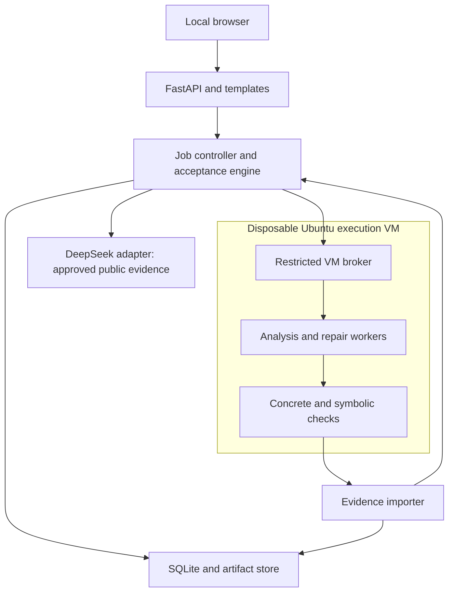

# Technical Design Document: BinaryRepair MVP

**Version:** 1.0  
**Date:** 15 October 2026  
**Status:** Technical direction confirmed; detailed implementation design and defaults proposed below; feasibility experiments not yet performed.  
**Audience:** Five first-year students with basic Python knowledge, using AI assistance while learning and reviewing critical code.

## 1. What we are building

BinaryRepair is a local analyst tool for repairing a known vulnerability in a binary without original source code. Its completed MVP must repair the same public stack-buffer-overflow defect in the same Linux x86-64 ELF through two routes: instruction patching and recovered-C repair with compilation and reintegration. Each route produces a separate candidate and passes the same validation requirements.

The principal concern is whether repairs block the specified unsafe behavior while preserving required behavior. Therefore the acceptance engine, contracts, negative tests, and evidence records are core components, not optional reporting features. AI proposes candidates; deterministic checks control acceptance.

### Delivery boundaries

| Stage | Required outcome | Timing |
|---|---|---|
| Proposal | Credible scope, architecture, verification plan, risks, and honestly labeled evidence | Next week, approximately 22 October 2026; exact time TBD |
| Progress demonstration | Working local GUI and a partially completed repair pipeline; unfinished stages visible | Next week; exact demonstration date TBD |
| Completed MVP | PRD F1–F5, both routes successful on the same public binary, shared checks and replay | Deadline TBD after feasibility experiments |
| Next milestone | Named real-world CVE | Selection and date TBD |
| Final application | Broader supported workload and client acceptance process | Scope and date TBD |

Team capacity is five hours per member per week: **25 person-hours total**, including learning, review, integration, and demonstration preparation. Next week's demonstration is not a promise of completed binary repair or verification. Both routes remain mandatory for the completed MVP.

### Precedence and evidence

The PRD defines product acceptance. Later confirmed interview answers add Ubuntu, one operator on one computer, mixed AI-assisted development, DeepSeek for development and product inference, and the progress-demo milestone. These later answers supersede the earlier suggestion of a full MVP next week. Earlier research recommendations for CLI-only operation and strictly in-place patches do not apply.

This is a design document. No application, VM, sample build, patch, provider benchmark, or proof was produced while writing it. Documentation supports tool capabilities; it does not establish joint compatibility or success on the selected sample. Implementation defaults below are engineering recommendations, not additional requirements previously approved by the user.

## 2. Chosen approach and alternatives

Use a Python application with a small web interface, local records, and separate analysis/execution workers. A worker is a process responsible for expensive work; a process by itself is not a security sandbox.

| Decision | Selected design and reason | Alternatives and trade-offs |
|---|---|---|
| GUI | FastAPI + Jinja2 HTML, local CSS, small JavaScript polling; one language for most application logic | Streamlit: faster initial screens, less control over workflow/session behavior. React + FastAPI: richer interface, adds JavaScript tooling and integration work |
| Application architecture | Modular Python application with separate worker processes; simple deployment while keeping analysis off the request thread | All work in HTTP handlers: initially simpler, poor cancellation and responsiveness. Celery/Redis: useful for larger queues, adds services unnecessary for one operator |
| Job records | SQLite plus immutable local artifact files; supports structured jobs and replay without a database service | JSON files alone: simple, weaker transactions and querying. PostgreSQL: better multi-user concurrency, extra operations |
| UI progress | Poll persisted events/status every two seconds while work runs | SSE: convenient live updates, additional reconnect logic. WebSockets: flexible bidirectional channel, unnecessary here |
| Isolation | Disposable Ubuntu x86-64 VM for parsing, compilation, binary testing, and symbolic analysis | Hardened containers: lighter, share host kernel. Dedicated physical machine: strong separation but more hardware and transfer work |
| Route A | Small reviewed instruction templates, Capstone decoding, LLVM assembly; controlled writeback | Unrestricted generated assembly: broad search, harder review. Keystone: convenient bindings, another dependency to test |
| Route B | Ghidra recovery; whole-function repair; Clang compilation; evaluate Patcherex2 behind an adapter | Custom relocation/reintegration engine: control, substantial engineering. SCRIBE: relevant research alternative, adoption requires a separate dependency and interface investigation |
| ELF operations | LIEF for inspection; small byte writer for fixed-size edits; tested backend for added code | LIEF for every rewrite: convenient, may change layout beyond intended bytes. Completely custom ELF writer: smaller dependency surface, high correctness burden |
| Verification | Frozen contract, structural/ABI checks, concrete regression, bounded angr/Claripy analysis | Tests only: practical but misses untested paths. General formal equivalence: much greater modeling effort than this MVP can promise |
| Product AI | DeepSeek through a replaceable provider adapter; constrained structured candidates | Another hosted model: useful comparison later, no demonstrated benefit yet. Local inference: stronger control over data, hardware and quality untested |

These choices favor a maintainable learning project over public-service scale. FastAPI documents Jinja2 integration [D1]. Its background-task caveat reinforces keeping expensive analysis separate [D2]. The specific worker/VM design is our engineering recommendation, not a framework guarantee.

No public hosting, cloud database, payments, email, analytics service, or account system is required. Keep all source in a team-controlled Git repository. A visual builder is unnecessary.

## 3. Environment and dependency policy

**Recommended baseline:** Ubuntu 24.04 LTS amd64 host and guest, Python 3.12 for the application, Chromium/Chrome for primary demonstration testing, Firefox for a smoke test. These are proposed targets; first record the actual host architecture, Ubuntu release, RAM, free disk, and virtualization availability. “Ubuntu” alone does not confirm an x86-64 CPU.

**Planning hardware allowance:** 4 guest vCPUs, 8 GiB guest RAM, and 30 GiB guest disk; a host with 16 GiB RAM and at least 50 GiB free disk is a reasonable initial target. These are estimates, not measured minimum requirements. Run expensive tasks sequentially. If the host cannot support this, retain GUI/static work and mark execution unavailable until the environment is resolved.

Application dependencies: FastAPI, Uvicorn, Jinja2, Pydantic, multipart upload support, a DeepSeek-compatible client, pytest, Ruff, and mypy. Use Python's SQLite interface and explicit SQL migrations. Workers add Ghidra/JDK, Capstone, LIEF, LLVM/Clang, binutils/GDB, angr/Claripy/Z3, and the selected reintegration backend.

Do not install every package at its independently newest version. Select and freeze a jointly tested set after environment smoke tests. Record OS/kernel, Python/JDK, Ghidra release, backend commit, compiler flags, dependency lock, solver version, and guest-image hash. Separate tool environments if backend and verifier dependencies conflict.

No compatible lockfile or runnable installation sequence is supplied as an achieved result. Part 4 should prepare project configuration; subsequent implementation must test and pin it.

## 4. Architecture and trust boundaries



The trusted host serves the GUI, records approvals, makes provider calls, schedules jobs, imports artifacts, and calculates acceptance. Uploaded binaries, decompiler output, generated C, assembly, and guest output are untrusted data. The host does not run uploaded executables or compile model-generated C.

The broker supports a fixed list of operations such as analyze, assemble, compile, apply, test, and verify. Inputs are typed manifests and artifact identifiers, not arbitrary shell commands. Tool arguments are constructed from validated values and passed as argument arrays. Output size, execution time, and filesystem scope are limited.

The VM has no API credentials, host home mounts, shared clipboard, or internet route during a job. Transfer bounded input bundles through a dedicated staging mechanism; retrieve regular files only, rejecting symlinks, traversal, device files, oversized output, and unexpected names. A small supervisor/guest agent must itself be tested. The VM boundary reduces exposure; it does not prove that guest results are trustworthy against an intentionally hostile binary.

For the first public fixture, use a disposable job snapshot and an unprivileged execution user. Keep trusted tool executables and baseline files read-only to that user. Snapshot reset between test runs is preferred; do not let a candidate alter a later test's oracle. Full hostile-client-binary hardening is outside the demonstrated capability until separately evaluated. libvirt's domain configuration is a primary reference for implementing this boundary [D11].

## 5. Supported binary and sample profile

Begin with one uncomplicated public CWE-121 case, preferably selected from NIST Juliet C/C++ 1.3 [D12]. The suite is a source of fixtures, not evidence that any selected binary works with both routes.

Recommended initial supported profile:

- ELF64, little-endian, EM_X86_64, non-PIE ET_EXEC; single process and single thread.
- Small C function with a reviewed System V AMD64 scalar/pointer interface, identifiable entry, ordinary returns, and bounded input processing.
- No packed/self-modifying code, TLS-dependent repair region, C++ exceptions, unusual unwind behavior, or unresolved indirect incoming transfers into overwritten bytes.
- No new external library dependency in replacement code; allow only explicitly resolved existing calls.
- Start with retained function symbols for localization, while excluding original source and DWARF/source paths from repair inputs. Disclose all hints.
- Preserve existing protections; do not silently disable NX, RELRO, stack protection, or control-flow protections. If the adapter cannot preserve a present feature, return unsupported.

This deliberately narrow technical profile does not imply support for every Linux ELF. Extending to PIE/shared objects, stripped binaries, complex relocations, or protected entry points needs another capability gate.

### Fixture selection gate

Before freezing the sample, demonstrate: a meaningful valid-input domain, a binary-level violation, Route A patch feasibility, Route B unchanged round trip, safe placement for both routes, and a verifier that detects the original violation. If a sample fails, record why and try another public case. Do not replace the same-sample requirement with two different examples without agreement.

Build fixtures in an evaluator-only workspace. The repair input contains the ELF, approved binary-derived metadata, tests, and contract; it excludes source, reference fixes, source maps, and evaluator annotations that reveal the fix. For public fixtures the provider might already know source material; disclose this evaluation limitation. Keep an independent test oracle and hidden test set outside model prompts.

## 6. Data, identity, and job lifecycle

### SQLite records

Use UUID text identifiers, UTC ISO timestamps, foreign keys, and a schema-version migration table. Suggested fields are an implementation contract, not a delivered SQL migration.

| Table | Key fields and relationships |
|---|---|
| jobs | id PK, original_sha256 TEXT, fixture_id TEXT nullable, classification TEXT, created_at TEXT, phase TEXT, cancel_requested INTEGER |
| contracts | id PK, job_id FK, revision INTEGER, body_json TEXT, sha256 TEXT, approved_at TEXT nullable, reviewer_label TEXT; UNIQUE(job_id, revision) |
| runs | id PK, job_id FK, contract_id FK, manifest_sha256 TEXT, idempotency_key TEXT UNIQUE, phase TEXT, outcome TEXT nullable, started_at/finished_at TEXT |
| attempts | id PK, run_id FK, route TEXT, sequence INTEGER, candidate_sha256 TEXT nullable, phase TEXT, outcome TEXT nullable, reason_code TEXT; UNIQUE(run_id, route, sequence) |
| obligations | id PK, attempt_id FK, kind TEXT, required INTEGER, result TEXT, scope_sha256 TEXT, evidence_artifact_id FK nullable |
| artifacts | id PK, job_id FK, attempt_id FK nullable, relative_path TEXT, sha256 TEXT, size_bytes INTEGER, media_type TEXT, role TEXT |
| events | integer sequence PK, run_id FK, attempt_id FK nullable, timestamp TEXT, event_type TEXT, payload_json TEXT |
| model_calls | id PK, attempt_id FK, provider/model TEXT, prompt_sha256 TEXT, status TEXT, usage_json TEXT, estimated_cost_usd REAL nullable |

Index events by run/sequence, attempts by run/route, and jobs by creation time. Store large tool output in files, not SQLite rows. Permit only short transactions, enable foreign keys, set a busy timeout, and consider WAL after a restart/concurrency test. SQLite WAL still permits only one writer at a time [D3]. Guest processes never access the database.

Write artifacts to a private temporary file, hash and validate, atomically rename into a job directory, then register metadata transactionally. Reconcile interrupted writes on startup; unregistered files cannot satisfy obligations. SHA-256 establishes identity, not correctness or authenticity.

### State semantics

Separate **phase** from **outcome**. Phases include draft, screening, awaiting_review, queued, analyzing, generating, applying, validating, and finished. Route B adds roundtrip. Outcomes match the PRD: success_within_scope, unsupported, rejected, inconclusive, error, and cancelled. A missing/not-implemented check is recorded as not_run, never passed.

Approval binds the original hash, contract revision, test-manifest hash, patch policy, environment profile, and verification scope. Editing any bound input invalidates approval and requires a new run. Preserve earlier runs.

Start runs with an idempotency key so double-clicking cannot create duplicate charged attempts. One controller leases one active job; routes run sequentially by default on the same machine. Lease heartbeats identify worker loss. After interruption, mark incomplete attempts error/interrupted and offer a new attempt; never infer success from partial files. Do not resume unsafe tools from an unknown intermediate state.

Cancellation first persists a request, then stops the current process tree/guest operation. Record cancelled only after termination is confirmed. If termination cannot be established, record error/termination_unconfirmed and prevent another job from using that VM until it is reset.

## 7. Feature and API design

The operator uses three views: setup/review, repair comparison, and evidence/export. Templates are server-rendered; JavaScript fetches small status updates. Use neutral typography, high contrast, text labels with icons, expandable raw details, and two route cards. Never use fabricated progress percentages. Completed, pending, unavailable, and diagnostic results remain visibly different.

| PRD feature | Implementation | Main failure conditions |
|---|---|---|
| F1 setup/review | Upload binary and tests, hash input, screen inside VM, show recovered function/location and editable contract, bind reviewer confirmation | Malformed/wrong architecture; incomplete contract; stale approval |
| F2 instructions | Template-constrained generation, independent encoding/decoding, placement audit, separate candidate copy | Mismatched bytes; unsafe overwrite/transfer; unsupported interface/placement |
| F3 recovered C | Preserve recovery and edits; unchanged round trip; security edit; compile/reintegrate; separate candidate | Round-trip regression; unresolved dependencies; unsupported ABI or placement |
| F4 validation | Shared acceptance engine consumes per-obligation evidence on final artifacts | Counterexample/regression rejects; incomplete required evidence is inconclusive |
| F5 comparison/export | Route cards, changed-region display, logs, HTML/JSON evidence and artifact export | Missing artifact/hash mismatch; diagnostic export mislabeled as accepted |

### Planned API surface

| Method and path | Contract |
|---|---|
| POST /api/jobs | Multipart ELF, typed test manifest and defect details; returns job ID and original hash |
| POST /api/jobs/{id}/analysis | Queue screening and binary-derived analysis; returns 202 and run/task identifier |
| GET /api/jobs/{id} | Summary, current contract, phases, capabilities and outcomes |
| PUT /api/jobs/{id}/contract | Validated contract body plus expected revision; returns new revision/hash |
| POST /api/jobs/{id}/approve | Exact expected input/contract/manifest/scope hashes; stale values return 409 |
| POST /api/jobs/{id}/runs | Approved revision and idempotency key; queue both routes, return 202 |
| GET /api/runs/{id}/events?after=sequence | Bounded incremental events and current summary |
| POST /api/runs/{id}/cancel | Idempotent cancellation request |
| GET /api/attempts/{id}/evidence | Obligations, scope, counts, changed regions and artifact IDs |
| GET /api/artifacts/{id}/download | Registered regular file only; attachment disposition and safe filename |
| POST /api/runs/{id}/exports | Prepare deterministic report bundle; returns artifact ID |

Use 422 for invalid structured input, 413 for size limits, 401/403 for session or origin failures, 404 for unavailable objects, and 409 for stale approvals or invalid state transitions. Represent a queued job's unsupported capability in job evidence rather than misleadingly returning HTTP success as repair success. Every response/error carries a correlation ID; never return shell traceback or secret-bearing provider bodies to the browser.

The test manifest contains argument arrays, stdin artifact IDs, expected return/stdout/stderr, and optional allowed output files. It cannot specify arbitrary host commands, shell scripts, or unrestricted filesystem paths. Only the selected target and allowlisted worker operations execute in the guest.

## 8. Repair contracts and route implementation

### Shared security contract

Freeze a versioned contract with input domain, intended valid behavior, forbidden behavior, invalid-input outcome, target entry/interface, authorized edits, allowed added mappings, environment assumptions, and required verification obligations. Derive capacities and addresses from inspected binary evidence; the model does not decide them without review.

For a counted-copy fixture, a useful proposed domain is input lengths 0–64 bytes with a small destination, but **actual capacity, byte constraints, and length limits are TBD until sample selection**. Valid inputs must preserve output/return values and relevant side effects. Overlong inputs must take a defined error path without an out-of-bounds destination access. Rejecting every input fails the valid domain. Null termination, embedded NULs, signed lengths, and off-by-one boundaries require explicit decisions if relevant to the fixture.

### Route A: instruction repair

1. Load frozen binary-derived metadata and confirm the original hash and exact target bytes.
2. Ask DeepSeek to select/parameterize a reviewed guard or constant-edit template compatible with the contract. The first implementation does not accept arbitrary machine-code plans.
3. Construct assembly deterministically, assemble at its real location, and decode independently with Capstone. Verify complete instruction coverage and expected targets. Capstone's documented detail mode exposes register information [D4]; it does not establish whole-function liveness.
4. Prefer an in-place edit if safe. Otherwise place the repair elsewhere through the supported backend and redirect only reviewed instruction intervals.
5. Check overwritten instructions, incoming edges, RIP-relative operands, branch reach, register/flag preservation, stack alignment, and return behavior. Relocate displaced instructions only when supported. Unknown live state or incoming transfers imply unsupported.
6. Apply to a copy, produce a complete edit manifest, and submit the final written file to shared validation.

LLVM assembly is the default tool-family recommendation [D5]. Exact assembler options and relocation handling must be tested with the selected backend; extracting object-file bytes alone is not linking.

### Route B: recovered C and reintegration

1. Use Ghidra to recover a small whole function and its signature/references from the original ELF. Headless automation is documented [D6]; the exporter and JDK compatibility still need implementation.
2. Preserve raw C-like output, normalized compilable C, interface assumptions, and every manual/AI correction with a diff and reason. Do not replace recovery with evaluator source.
3. Compile and reintegrate the normalized **unrepaired** function into a copy. Require compatibility and agreed valid-input regression checks. Establish that the known defect remains observable within the agreed analysis scope; its accidental disappearance must be investigated as a behavior change, not counted as repair.
4. If that round trip fails, stop this route with a specific rejected/unsupported/error outcome. A successful round trip provides evidence on its tested scope, not complete equivalence.
5. Ask DeepSeek for a constrained security edit to the recovered function, compile it, inspect symbols/references, and reintegrate with the same approved interface.
6. Hash the final executable and run every shared required check. A standalone compiled function or a successful compilation cannot substitute for testing the final ELF.

Patcherex2's documented function-replacement example makes it the first reuse experiment [D7]. The example does not prove safe recovery, compatibility, or verification for this fixture. Adopt its adapter only after demonstrating the unchanged round trip, layout audit, and reproducible final execution. If it fails, evaluate a narrower custom function-replacement adapter or SCRIBE separately; do not silently omit Route B.

### Added-code policy

Both routes may add code elsewhere. Prefer reviewed existing space; zero bytes alone do not establish unused executable storage. Otherwise allow a new mapped RX region and necessary metadata changes through a tested backend. Record every changed file interval, virtual mapping, header, relocation, and detour. New section names alone do not establish runtime mapping; inspect loadable segments and permissions using LIEF and independent readelf output [D8].

Reject overlap with live data/code, unresolved relocation, unsafe permission broadening, inaccessible branch targets, or unhandled loader/protection metadata. Preserve original load addresses where required by the narrow profile. Unavoidable unsupported movement returns unsupported. Minimize unnecessary edits and report changed/added bytes separately; no claim of global minimality.

## 9. Verification and acceptance engine

### Verification ladder

| Gate | Required evidence | What it establishes |
|---|---|---|
| V0 identity/preconditions | Hashes, approval, environment, complete required inputs | Checks refer to the intended frozen artifacts |
| V1 structure/placement | Parse/load map, edit manifest, instruction/transfer review, permissions, dependencies | Candidate meets supported structural constraints |
| V2 interface/compatibility | Reviewed signature, stack/register obligations, loader execution, relevant metadata checks | Evidence for the supported ABI/runtime profile |
| V3 concrete behavior | Original reproducer, invalid-input oracle, boundary tests, valid suite, side-effect observations | Specified test cases satisfy their contract |
| V4 bounded symbolic security | Candidate-specific model, input domain, memory-access predicates, exploration/solver accounting | Required property holds within the explicitly reported model/domain, if complete |
| V5 reproducibility | Final hashes, versions, replay inputs and independent teammate replay | Evidence can be reproduced under recorded conditions |

Static compatibility checks are restricted checks, not a general ABI theorem. The original binary is a differential oracle only on defined-valid inputs. Vulnerable executions outside that domain have no required preservation behavior. Compare externally visible values and agreed files, not raw addresses or unrelated nondeterministic data.

### Symbolic verification design

Use angr with Claripy/Z3 on the **actual final candidate ELF**, including the original entry redirect and added code. Begin with function-level verification at the reviewed original entry for tractability; concrete end-to-end tests exercise loader and caller integration. The report must say function-level under entry preconditions, not whole-program verified.

Specify argument values, input buffers, readable/writable regions, stack initialization, lengths, and environment. Do not silently initialize unknown memory to zero or restrict bytes to remove difficult paths. Give each artifact a reviewed address/object map; Route B's different stack layout requires its own map. Unknown destination bounds cannot support a memory-safety claim.

Monitor writes for the target buffer/forbidden ranges along all relevant instructions, including newly compiled code. Check whether the path condition AND an out-of-bounds-access predicate is satisfiable. A symbolic address must be checked symbolically; do not rely on one concretized address. Also check defined safe termination/rejection where the contract requires it.

Library hooks must be enumerated and justified. A hook cannot replace the repaired function, guard, trampoline, or vulnerable operation with assumed-safe behavior. If an external memory-copy summary is necessary, model its reads/writes and lengths accurately for this domain and test that model against known unsafe and boundary cases. Prefer a fixture whose critical operations execute as actual instructions.

Report all active, terminal, errored, unconstrained, deferred, and resource-pruned states. A path budget is a computational guard, not permission to discard reachable states and accept. Completion requires that all states in the claimed bounded domain are accounted for and every relevant solver query is decided. If a loop/state/time limit prevents completion, report inconclusive unless the excluded behavior is explicitly outside the frozen input-domain contract. Track source-domain bounds separately from computational limits.

Calibrate the verifier by finding a concrete violation in the original and a deliberately defective diagnostic candidate under the same property/domain. Replay counterexamples concretely when possible. A discrepancy blocks acceptance pending model diagnosis. angr documents modeling and concretization limitations [D9] and state-management categories [D10]; the instrumentation and acceptance rules above remain implementation work.

### Acceptance rules

- A counterexample or failed required behavioral/compatibility check rejects the candidate.
- An unsupported interface/placement/profile returns unsupported; it cannot satisfy the demonstration.
- Required not_run, unknown, timeout, incomplete exploration, or unvalidated modeling assumptions prevent success and produce inconclusive when evidence is the issue.
- Tool/provider crashes produce error; cancellation remains distinct. Preserve failed check evidence even if a later tool also fails.
- Success_within_scope requires every required obligation to pass, with matching final hashes and a nonempty, reviewed scope. UI labels include the bounds and assumptions.
- Both routes must individually succeed for full MVP acceptance. One accepted route, a prior run, or a deterministic reference repair cannot substitute for the missing route.
- Next week's partial demonstration can complete without accepted candidates, but must show an implementation-coverage summary separate from repair outcome.

## 10. DeepSeek integration and development assistance

### Product inference

Implement a provider interface: request_candidate(context, route, limits) returns a validated candidate or typed failure. The host adapter calls DeepSeek's documented API using a configurable endpoint/model and separate product key. Start by evaluating the documented `deepseek-flash` option; pin the exact returned model/version and settings after a public-case smoke test, rather than promising repair quality from the model name [D13]. Provider/model availability remains an operational check.

For initial compatibility use JSON output mode plus strict local Pydantic validation. DeepSeek documents JSON mode and warns about empty content [D14]. Valid JSON is not schema validity or semantic correctness. If a stronger schema feature is adopted, test it on the chosen endpoint/model; never remove local checks.

Candidate schema v1 contains: schema_version, original_sha256, contract_sha256, analysis_sha256, route, target_entry, evidence_ids, template_id and typed parameters for Route A, recovered_function_sha256 and replacement_c for Route B, expected_effects, assumptions, and uncertainties. Forbid extra fields; validate hashes, integer ranges, target membership, string sizes, and route-specific fields. The server supplies allowed locations/interfaces; the model cannot expand them. Candidate payloads contain no executable host commands, requested permissions, credentials, or claimed proof results.

Allow approved public binary-derived excerpts, recovered C, contract, and relevant diagnostic results. Send only necessary context, not all job artifacts. Client binaries AND confidential derived content are denied external inference unless an explicit client authorization covers that transfer. A local model is a future adapter, not already implemented. Apply the same boundary to the coding agent and its workspace access.

Provider/account terms, retention/training treatment, region, and any gateway forwarding must be checked before use with confidential material. The public privacy policy is not evidence of a specific API zero-retention agreement [D15]. The public fixture path can proceed under the user's existing authorization; no confidential-client readiness is implied.

### Proposed operational defaults

| Limit | Starting default; tune after measurement |
|---|---|
| Active work | One job; sequential route execution |
| Upload size | 20 MiB ELF; 10 MiB combined tests |
| Candidate generation | At most three candidate attempts per route |
| HTTP model calls | At most six per route including retries; one transient retry per request, bounded backoff |
| Model context/output | 24,000 input tokens and 4,000 output tokens per call, subject to actual accounting/capability |
| Provider timeout | 120 seconds total per call; record failure and usage if available |
| Analysis/round-trip step | 300 seconds before explicit timeout |
| Concrete test | Two seconds per process, 1 MiB captured output, bounded file writes |
| Symbolic attempt | 120 seconds and 4 GiB memory; exceeding limits means inconclusive |
| Job | 30 minutes and 1 GiB new artifact quota; controller enforces remaining budget |
| API spending | Proposed USD 2 per job and USD 20 for initial public-case experiments; operator configurable |
| Retention | No automatic deletion before milestone review; explicit cleanup after export, recommended review at 30 days |

These numbers are configurable engineering defaults, not measured performance or guaranteed deliverability. Reserve conservative call cost before sending; bound all billed output categories supported by the provider. If reliable upper-bound accounting is unavailable, enforce a small call cap and report that monetary control is approximate. Do not silently retry a timed-out billed call. Unknown usage is unavailable, not zero.

On schema failure, empty/truncated content, or exhausted provider retries, preserve diagnostics and stop or try another candidate within the same caps. Never fabricate an AI response or positive verification. A deterministic template baseline may be displayed as a separate evaluation mode; do not label it as a successful AI-assisted route.

Do not add vector search, a broad vulnerability database, autonomous multi-agent orchestration, or an agent framework initially. A finite workflow and reviewed templates suffice for this sample. Untrusted binary strings cannot alter prompts' permissions, call tools, or change scope.

### Coding workflow

The team chose an existing coding agent connected to DeepSeek; its exact application and configuration remain TBD. Keep that choice rather than substituting another named agent. Ask it to implement one reviewable change at a time, explain the change, and report tests and limitations. The product uses a separate adapter and permissions; an interactive development agent does not run inside production repair jobs.

Require human cross-review of contracts, edit placement, C normalization, verifier instrumentation, acceptance rules, and sandbox changes. Commit prompts/configuration without credentials. Never let an agent weaken tests, rewrite expected outcomes, or remove verification gates merely to obtain green results.

## 11. Local-service security and artifact handling

Bind the GUI service to 127.0.0.1. Use a random local session token established through a launcher-to-browser bootstrap, then an HttpOnly SameSite=Strict session cookie. Remove the one-time token from the address bar, do not log it, and reject its reuse. Validate Host and Origin; require a CSRF token on state-changing requests. Disable permissive CORS. The setup uses local HTTP; do not claim transport encryption or expose it remotely.

Use template escaping and DOM textContent for untrusted output. Serve local static assets with a restrictive CSP; set nosniff and frame restrictions. Force downloads for binaries/raw artifacts. Render generated evidence HTML through trusted templates; never display worker-supplied HTML as active content. Keep session/auth tokens and API keys out of reports, browser bundles, guest environment, and logs.

Store original bytes read-only under server-generated paths. Validate content, not just extension; enforce streamed size limits and quotas. Reject archive extraction initially. Exports contain registered safe relative paths and an independently generated hash manifest; do not package arbitrary job-directory contents. Flag failed/inconclusive artifacts as diagnostic candidates. Export is not production approval.

Access protection must be tested even for localhost: a malicious webpage can attempt requests to local services. Multi-user accounts, OAuth, remote access, and enterprise authorization remain out of scope.

## 12. Project layout and setup contracts

Suggested modules, to be created during setup/implementation:

| Path | Responsibility |
|---|---|
| app/main.py; app/api/ | FastAPI entry, local-session checks, typed routes |
| app/templates/; app/static/ | Three views, CSS, status polling |
| app/domain/ | Contracts, candidate schemas, phases/outcomes, acceptance rules |
| app/services/ | Job controller, provider adapter, artifact/export services |
| app/db/; migrations/ | Parameterized SQLite access and schema migrations |
| workers/analysis/ | Headless Ghidra and ELF metadata extraction |
| workers/route_a/; workers/route_b/ | Route adapters and round-trip gate |
| workers/verification/ | Structural, concrete, symbolic checks |
| workers/broker/ | Narrow VM task protocol and resource enforcement |
| tests/unit/; tests/integration/; tests/e2e/; tests/evals/ | Acceptance semantics, worker integration, GUI, AI boundary scenarios |
| fixtures/public/ | Public binary inputs and provenance, with no evaluator source |
| docs/ | PRD, research, technical design, decisions and replay guide |
| var/jobs/ | Runtime artifacts; excluded from source control |
| pyproject.toml; requirements.lock | Project metadata and tested dependency lock |

The evaluator source/build workspace is outside the application checkout provided to repair workers and model prompts. A source repository folder merely hidden from the GUI is insufficient separation.

### Planned development commands

These are specifications for files to create later, not commands executed or known to work against an existing repository. Part 4 must establish the project metadata, migrations, fixtures, and VM adapter before treating them as runnable.

```bash
python3 -m venv .venv
.venv/bin/python -m pip install -e '.[dev]'
.venv/bin/python -m uvicorn app.main:app --host 127.0.0.1 --port 8000
.venv/bin/python -m pytest
.venv/bin/python -m ruff check .
.venv/bin/python -m mypy app
```

Run from the future project root. The editable install is for development; milestone replay uses the tested lock and guest image. The API starts with execution disabled until the isolation self-check passes. Add an explicit GUI-only development mode using stored or synthetic results, clearly labeled; it must never emit accepted-patch evidence.

Proposed configuration names: DEEPSEEK_API_KEY, DEEPSEEK_BASE_URL, DEEPSEEK_MODEL, BINARYREPAIR_DATA_DIR, BINARYREPAIR_EXECUTION_ENABLED, BINARYREPAIR_VM_PROFILE, BINARYREPAIR_JOB_COST_LIMIT_USD, and BINARYREPAIR_CANDIDATE_LIMIT. Only the trusted provider process receives the API key. Exact coding-agent configuration is separate and TBD.

## 13. Testing and evidence replay

Focus on meaningful failure conditions and critical flows, without an arbitrary percentage-coverage target.

| Test group | Required scenarios |
|---|---|
| Acceptance engine | Required unknown/not_run cannot pass; failed regression rejects; cancelled/error distinct; both routes needed |
| Identity/state | Wrong hash/old approval rejected; duplicate start idempotent; contract changes invalidate approval; restart cannot accept partial output |
| Repair integration | Wrong architecture; unexpected bytes; no safe placement; malformed candidate; unresolved relocation; failed Route B round trip |
| Security verifier | Detect original violation and defective candidate; boundary/off-by-one cases; unknown/timeout/errored/unconstrained states stay non-success |
| Behavior | Empty, smallest, typical, maximum valid input; first invalid and longer input; oracle includes required return/output and side effects |
| AI integration | Empty/invalid output; wrong identity; provider failure; budget exhaustion; injection strings; unauthorized confidential transfer |
| Local boundary | Missing session, cross-origin POST, traversal/symlink export, malicious HTML output, guest credential/network isolation |
| GUI | Setup → review → start → compare → export; responsive during work; cancellation; browser refresh; unfinished stages visible |
| Replay | Independent teammate repeats both routes' validation from frozen candidates and manifests without original source |

Use pytest for unit/integration tests and Playwright Python for the critical browser journey once the application exists. Keep actual binary execution out of ordinary host/CI tests. CI can run schema, state, lint, type, and mocked-worker tests; real binary checks require the disposable VM.

For UI work, render the three screens, inspect readable statuses and error states, and refine before merging. A failing test requires diagnosis; do not automatically change the oracle. Record the failing case, root cause, change, and rerun evidence.

### Export bundle

Include original/candidate hashes, route/attempt identity, approved contract and test manifest, complete edit manifest, raw/normalized/repaired C and diffs for Route B, instruction plan for Route A, model/settings/prompt-template identifiers, relevant public request/response content, usage or unavailable labels, tool versions, commands/argument manifests, required obligations, solver/exploration records, counterexamples, and human-readable HTML plus machine-readable JSON reports. Exclude credentials, local session secrets, and unauthorized confidential content.

Replay validates candidate bytes and environment, then reruns validation. It does not require reproducing identical stochastic model output. Record whether replay starts from the original to reproduce patch generation or from a frozen candidate to reproduce its evidence. Both are useful, but they establish different things.

## 14. Next week's 25-hour progress plan

This is a planning allocation, not a guarantee. Each member has five hours; time is included for explanation and review. Everyone learns the same basic pipeline, then takes one primary slice. Named owners remain TBD.

| Member | Five-hour allocation | Reviewable result |
|---|---|---|
| 1: integration/proposal | 1 h foundations; 2 h controller/contract model; 1 h integration; 1 h proposal | Frozen scope, persistent job identity, proposal architecture |
| 2: GUI | 1 h foundations; 3 h setup/comparison/evidence screens; 1 h review | Working local browser flow with truthful stage labels |
| 3: binary/sample | 1 h foundations; 2 h public-fixture and VM feasibility; 1 h ELF inspection; 1 h review | Provenance and real input metadata, or explicit setup blocker |
| 4: verification | 1 h foundations; 2 h acceptance rules and negative tests; 1 h symbolic-model spike; 1 h review | Failure-safe outcome handling and documented verifier scope/gap |
| 5: AI/Route B feasibility | 1 h foundations; 1 h DeepSeek schema adapter; 1 h decompile/round-trip spike; 1 h integration/replay; 1 h review | Real bounded model call if configured; Route B feasibility notes |

Target a coherent vertical slice: create a job, hash/screen the ELF, record a reviewed contract, show actual completed analysis or candidate-generation results, display both route states, and export an honest partial report. Route A application and Route B round trip are stretch outcomes this week; neither is assumed complete.

If isolation/sample setup consumes the available time, keep the GUI and acceptance engine working with clearly labeled synthetic development data, present the real blocker, and leave execution unavailable. Do not run binaries on the host to make the demonstration appear complete. Historical evidence may be shown only as a labeled replay with its input hash/date.

### Gates before scheduling the completed MVP

1. Freeze supported sample, contract, oracle, and source separation.
2. Demonstrate safe Route A placement and Route B unchanged round trip on that sample.
3. Calibrate the symbolic property/model on known unsafe behavior; establish an attainable complete bounded domain.
4. Integrate both final artifacts with all required evidence and GUI exports.
5. Independently replay, review failures, then accept the two-route MVP.

Re-estimate after gates 1–3. No reliable full-MVP duration is established. With capacity fixed at 25 hours/week, a measured remaining effort E person-hours implies E/25 weeks before dependency and calendar overhead; it is not a delivery commitment.

## 15. Costs, maintenance, and risks

Budget is flexible, but the design does not require paid hosting or a database subscription. Existing hardware and open tooling avoid new service charges; hardware adequacy and licenses of pinned dependencies still require review.

| Item | Budget treatment |
|---|---|
| Local GUI/SQLite/storage | No additional hosted-service charge planned; local electricity/storage not estimated |
| VM and analysis tooling | Use existing hardware first; purchase/compute quote TBD only if measurement identifies a need |
| Product DeepSeek usage | Meter by actual model/token categories; proposed USD 20 initial experiment allowance |
| Development coding agent | Existing selected agent; subscription/gateway and usage costs TBD; track separately |
| Hosting/analytics/email | Not required |

At review on 15 October 2026, DeepSeek's official pricing table lists peak cache-miss input/output prices per million tokens of USD 0.30/1.20 for its Flash offering, with lower off-peak rates [D13]. An illustrative 10,000 input plus 4,000 output-token request costs USD 0.0078 at those rates, before any other billable usage. This arithmetic is not measured cost per repair; reasoning, actual usage categories, retries, development-agent calls, gateway fees, and changing prices must be accounted for. Verify the live table and account before spending. Monetary caps are implementation defaults, not permission to purchase services.

Track stage durations, error reasons, state counts, changed/added bytes, regression counts, usage/cost availability, disk growth, and manual interventions. Log structured events locally; exclude keys and confidential payloads. Back up SQLite using a consistent snapshot/backup method together with referenced artifacts, not an arbitrary copy of a live database alone. Restore-test before relying on backups. Review dependency changes after milestones; updates must rerun relevant compatibility and negative checks.

| Risk | Consequence | Response |
|---|---|---|
| Incorrect contract/oracle | A harmful patch appears correct | Cross-review valid/invalid domain and hidden evaluator tests |
| C normalization changes behavior | Round trip corrupts required function | Mandatory unchanged gate and retained edit history |
| Backend moves code unsafely | Broken branches, globals, loader state | Independent edit/mapping audit; unsupported on unresolved cases |
| Symbolic model skips behavior | False assurance | Baseline calibration, explicit hooks and complete state accounting |
| GUI reports success prematurely | Misleading demonstration | Central acceptance engine; no UI-only success logic |
| Incompatible tool versions | Work stalls | Early smoke tests, separate environments, tested lock |
| Limited weekly capacity | Milestone overrun | Partial demo boundary, capped spikes, no silent route removal |
| Client material leaks through agent/API | Confidentiality breach | Default-deny external transfer and separate trusted provider boundary |

A real-world CVE is the next milestone, not a trivial consequence of one fixture. Broader ELF support, local models, remote collaboration, enterprise deployment, and final-app guarantees each require a scoped decision and new evidence. There is no current need for a microservices or multi-tenant scaling plan.

## 16. Open questions and implementation experiments

All items below are **TBD**; none requires repeating already confirmed product choices.

1. What are the exact proposal/demonstration date, time, and required submission format?
2. Which Ubuntu release, CPU architecture, RAM/disk, and virtualization support are actually available?
3. Which named coding-agent application/gateway is connected to DeepSeek, and what data/settings does it use?
4. Which public fixture/member/build supports both routes, and what hints/symbols are supplied?
5. What are the exact valid/invalid domains, return/output expectations, destination capacity, oracle, and reviewed contract?
6. Which Ghidra/compiler/backend/verifier versions pass joint smoke tests, and what is their license inventory?
7. Can the unchanged recovered-C round trip and added-code mapping pass their required checks?
8. What precise bounded symbolic property/domain completes on the hardware, and which models need validation?
9. Which DeepSeek model/account/endpoint/settings pass schema and candidate-quality evaluations; what retention/training terms actually apply?
10. Are the proposed time, token, storage, spending, and retention defaults appropriate after initial measurement?
11. Who owns each workstream and independently reviews contracts, placement, and verifier code?
12. What are the completed-MVP/final-app dates, client acceptance process, and later CVE?

The build metadata command is empty in the final JSON because this design has no separate frontend compilation and the packaging/distribution command has not been chosen. Other listed commands are planned interfaces requiring Part 4 project files and implementation; they were not executed.

## 17. Official documentation and learning references

Reviewed on 15 October 2026. References support tool capabilities and limitations; proposed architecture and defaults are our engineering judgments. The supplied research remains additional background; its unexecuted experiments remain unexecuted here.

| ID | Primary source | Relevance |
|---|---|---|
| D1 | [FastAPI templates](https://fastapi.tiangolo.com/advanced/templates/) | Jinja2 integration and local HTML rendering |
| D2 | [FastAPI background tasks](https://fastapi.tiangolo.com/tutorial/background-tasks/) | Distinction between response tasks and heavier work |
| D3 | [SQLite WAL](https://www.sqlite.org/wal.html) | Concurrency limits and local persistence behavior |
| D4 | [Capstone Python guide](https://www.capstone-engine.org/lang_python.html) | Instruction decoding/detail APIs |
| D5 | [LLVM llvm-mc](https://llvm.org/docs/CommandGuide/llvm-mc.html) | Assembly and object generation |
| D6 | [Ghidra AnalyzeHeadless](https://ghidra.re/ghidra_docs/api/ghidra/app/util/headless/AnalyzeHeadless.html) | Headless automation entry point |
| D7 | [Patcherex2 function replacement example](https://purseclab.github.io/Patcherex2/examples/modify_function_patch/) | Candidate reuse path, not tested integration |
| D8 | [LIEF ELF Python API](https://lief.re/doc/latest/formats/elf/python.html) | Parsing, segment and relocation operations |
| D9 | [angr gotchas](https://docs.angr.io/en/latest/advanced-topics/gotchas.html) | Modeling and concretization limitations |
| D10 | [angr simulation managers](https://docs.angr.io/en/latest/core-concepts/pathgroups.html) | State categories and exploration bookkeeping |
| D11 | [libvirt domain configuration](https://libvirt.org/formatdomain.html) | VM device/network/filesystem configuration reference |
| D12 | [NIST Juliet C/C++ 1.3](https://samate.nist.gov/SARD/test-suites/112) | Public-case selection and provenance |
| D13 | [DeepSeek models and pricing](https://api-docs.deepseek.com/quick_start/pricing/) | Configurable model selection and cost arithmetic |
| D14 | [DeepSeek JSON output](https://api-docs.deepseek.com/guides/json_mode/) | Response configuration and empty-output caveat |
| D15 | [DeepSeek privacy policy](https://cdn.deepseek.com/policies/en-US/deepseek-privacy-policy.html) | General policy; not an API-specific retention guarantee |

Learning order: explain file offsets versus runtime addresses; inspect one function's arguments/stack and copy behavior; read its recovered C; trace one patch and its changed bytes; define the valid-input oracle; explain SAT/UNSAT/unknown and incomplete exploration; then integrate the GUI. Each teammate should be able to explain why a rejected or inconclusive result must not be accepted.

## 18. Design review checklist

- [x] Preserves PRD F1–F5, same binary/defect and both required routes.
- [x] Carries forward confirmed Ubuntu, one operator, DeepSeek and mixed learning approach.
- [x] Separates next week's partial demonstration from completed-MVP acceptance.
- [x] Compares major choices, including their costs and limitations.
- [x] Specifies contracts, artifact identity, state/outcome semantics and shared validation.
- [x] Requires unchanged Route B round trip and actual final-executable checks.
- [x] Covers local access, isolation, credentials, API boundaries and failure outcomes.
- [x] Includes test/replay plans, 25-hour allocation, operational defaults and open experiments.
- [x] Keeps unbuilt code, untested commands and unverifiable guarantees clearly labeled.
- [x] Includes self-contained handoff and final machine-readable metadata.

---
*Technical design: BinaryRepair MVP, version 1.0*  
*Confirmed direction: 15 October 2026*  
*Implementation evidence: none produced in this design task*  
*Completed-MVP delivery estimate: TBD after feasibility gates*  
*Next review: after the public fixture, round-trip, and verifier experiments*

## Handoff Context

- Stage: techdesign
- App name: BinaryRepair
- Full title: AI-Driven Automated Binary Vulnerability Repair and Correctness Verification
- User level: C — five first-year students, basic Python; mixed AI implementation and team understanding/review/testing
- Target platform: one Ubuntu computer, one operator, local browser GUI; Linux x86-64 ELF worker target; actual host architecture/version/hardware TBD
- Budget: flexible; no hosted GUI/database required; USD 20 initial API allowance and USD 2/job are proposed configurable defaults, not committed purchases
- Timeline: proposal and progress demonstration next week, approximately 22 October 2026, exact date/time TBD; demo accepts working GUI plus partial pipeline; completed-MVP and final-app deadlines TBD
- Capacity: five hours/member/week, five members, 25 total person-hours/week
- AI in product scope: yes; DeepSeek for candidate generation and development assistance, replaceable provider adapter
- Chosen stack: Python, FastAPI, Jinja2 server-rendered HTML, local CSS/minimal JavaScript polling, SQLite and local artifacts, separate workers in disposable Ubuntu VM; Ghidra/Capstone/LLVM/LIEF and angr/Claripy/Z3; Patcherex2 first Route B backend experiment, adoption contingent on feasibility
- AI coding tool: existing coding agent connected to DeepSeek; exact agent/gateway/configuration TBD; do not substitute a different coding tool without reason
- Main concern: verifying patch security and preservation of required behavior
- Constraints: binary-only repair pipeline, evaluator source separated; same public stack-buffer-overflow defect and original ELF for both routes; separate candidates; reviewer-approved location/contract; public-case hosted inference allowed, client binaries and confidential derived content local unless client explicitly authorizes external transfer
- Decisions: added code elsewhere allowed with documented layout changes; unsupported when safe placement/redirection/interface cannot be supported; mandatory Route B unchanged round trip; deterministic shared acceptance with bounded symbolic check on actual final candidates; unknown/missing required evidence never success
- Scope: F1 graphical setup/review; F2 instruction repair; F3 recovered-C repair/reintegration; F4 shared validation; F5 comparison/export; no public SaaS, payments, enterprise account system, automatic production patch deployment, broad discovery, unconditional equivalence, or global minimality claim
- Progress-demo policy: real GUI and completed backend stages; unimplemented stages show not_run/unavailable; synthetic development data or historical replay explicitly labeled; both routes remain required for full MVP
- Verification policy: valid-input regression, reviewed invalid-input outcome, structure/ABI checks, calibrated bounded symbolic memory-access property, complete state accounting in claimed domain, evidence replay by another teammate
- Open questions: exact sample/build/oracle/contract; actual host and virtualization; tested dependency lock/backend; symbolic domain/property completeness; exact coding agent; DeepSeek account/model/retention/settings; resource defaults; named owners; exact milestone dates and client acceptance
- Research status: supplied sourced literature/documentation research, not executed experiments; this design adds official-doc checks only, no application build or binary verification
- Source files: PRD-BinaryRepair-MVP.md; research-BinaryRepair.md; Pasted text(1).txt (Part 3 prompt) → docs/TechDesign-BinaryRepair-MVP.md
- Part 4 boundary: prepare project/agent files only when requested; full Part 4 prompt has not been provided; planned commands below require future repository files

```json
{
  "schemaVersion": 1,
  "documentType": "techdesign",
  "appName": "BinaryRepair",
  "stack": {
    "frontend": "Jinja2 server-rendered HTML with minimal JavaScript status polling",
    "backend": "Python and FastAPI; separate isolated analysis/execution workers",
    "database": "SQLite with explicit migrations; local immutable artifact files",
    "auth": "Local session token and CSRF protection; loopback-only single operator",
    "styling": "Local CSS",
    "deployment": "One Ubuntu computer; disposable Ubuntu x86-64 VM for untrusted work"
  },
  "commands": {
    "setup": "python3 -m venv .venv && .venv/bin/python -m pip install -e '.[dev]'",
    "dev": ".venv/bin/python -m uvicorn app.main:app --host 127.0.0.1 --port 8000",
    "test": ".venv/bin/python -m pytest",
    "typecheck": ".venv/bin/python -m mypy app",
    "lint": ".venv/bin/python -m ruff check .",
    "build": ""
  },
  "aiScope": "in-app AI"
}
```
