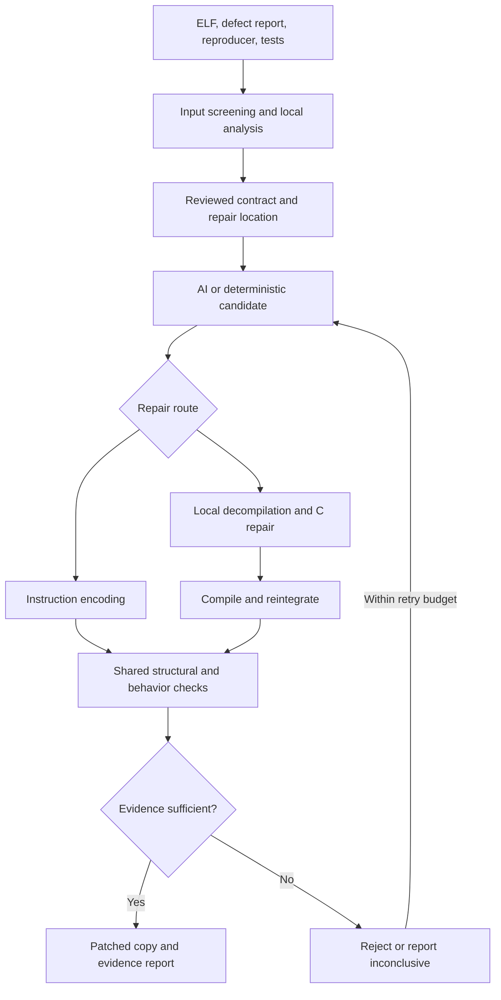

# BinaryRepair: feasibility and implementation research

Research status: Researched with sources

**Date and source access date:** 15 October 2026.
**Purpose:** evidence for a proposal due in one week, followed by an MVP and final application.
**Scope of research performed:** primary documentation, specifications, author repositories, and a research paper were reviewed. No toolchain was installed, sample compiled, patch executed, provider benchmark run, or correctness proof produced in this research. Recommendations and estimates below are planning judgments, not measured results. Sample-specific build compatibility remains unverified.

## 1. Executive feasibility assessment

**Recommendation:** propose a narrowly scoped repair-and-validation prototype for Linux x86-64 ELF, initially given a known defect, a reproducer, and a reviewer-confirmed target function. Implement both required routes against a deliberately restricted sample profile. Report evidence separately for security, preserved behavior, compatibility, and layout.

This is a plausible research prototype direction; the evidence does not establish that five beginners can deliver a general automatic repair application on an unspecified schedule.

Three findings materially change the proposal:

1. **Route B needs more than C compilation.** SCRIBE investigates syntactic and semantic inaccuracies in decompiled code and uses binary-derived metadata during recompilation. Its authors report repairing 13 of 14 evaluated real-world CVEs. This is evidence of a relevant method, not a success-rate prediction for your team, Ghidra-only workflow, or client binaries. [S1]
2. **Reusable patching infrastructure exists.** Patcherex2 documents Linux amd64 support and has a C-function replacement example. Reproduce that example before designing a custom reintegration engine. Its documentation does not establish your layout-preservation or correctness requirements. [S2, S3]
3. **Symbolic execution requires explicit modeling.** angr documents incomplete library summaries, unsupported system calls, and memory/length concretization. Consequently, simply failing to find a dangerous state is insufficient evidence of universal safety. [S4]

**Credible proposed claim:** “The prototype generates and validates candidate repairs for a defined class of known defects in selected Linux x86-64 ELF binaries, preserving specified valid-input behavior under documented assumptions.”

**Claims to avoid:** arbitrary-binary repair, all vulnerabilities removed, original source recovered, unconditional equivalence, globally smallest patch, or weeks-to-hours repair demonstrated without measurements.

The one-week deliverable is the proposal. Later implementation dates are unconfirmed.

## 2. Confirmed requirements and recommendations

| Category | Confirmed by user | Research recommendation, awaiting product agreement |
|---|---|---|
| Team | Five first-year students; basic Python only | Shared foundations before specialization |
| Client | Software company; binaries available, original source unavailable | Request defect description, reproducer, behavioral oracle, and execution environment |
| Target | Start with Linux x86-64 ELF | Begin with an unstripped, uncomplicated, single-process executable |
| Repair routes | Both direct instruction repair and local C repair/reintegration are required MVP capabilities | Demonstrate both on the same defect if feasible; otherwise disclose separate samples |
| Patch qualities | Minimal, compatible, verifiable; preserve layout/jumps/relocations as described | Define exact invariants and a finite supported patch policy |
| Verification | Block target vulnerability; preserve necessary normal behavior; original tests pass | Separate tests from model-dependent verification results |
| AI | Proposed repair logic generation with possible retrieval augmentation | Constrained proposals; deterministic validation and an AI-free baseline |
| Delivery | Proposal → MVP → final app | Proposal documents feasibility gates; final app begins as an analyst tool |
| Deadline | Proposal in one week | Working interpretation: approximately 22 October 2026; exact time TBD |
| Budget | Flexible | Use existing hardware first; capped API experiments |
| Final scope | Unclear | Keep supported defects, interface, and client release process open |

No details from other user projects or earlier conversations are imported. External work cited here is technical evidence, not additional client requirements.

## 3. Proposed stage boundaries

| Stage | Proposed deliverables | Evidence required | Explicit limitation |
|---|---|---|---|
| Proposal week | Problem, requirements, architecture, both-route feasibility analysis, sample plan, verification matrix, costs, risks | Source-backed rationale; clearly labeled optional experiments | No claim that the MVP has been built |
| MVP | One known weakness pattern; both routes; input screening; candidate validation; patched copies and evidence reports | Repeatable runs, valid/invalid-input checks, layout audit, bounded symbolic analysis | Narrow supported profile; manual localization/contract review disclosed |
| Final application | Repeatable analyst workflow across a selected held-out corpus; documented supported cases and refusal modes | Case-level results, failure rates, limitations, installation and rollback instructions | Corpus size, deployment environment, deadlines, and acceptance criteria TBD |

**Proposed exclusions for the MVP:** Windows, ARM, kernel code, packed/self-modifying binaries, C++ exception-heavy programs, multithreaded correctness, automatic discovery of arbitrary unknown vulnerabilities, general source recovery, and production hot patch deployment. These exclusions are recommendations, not user-approved restrictions.

## 4. Minimal toolchain and learning milestones

Use Python as the coordinator. An instruction decoder, compiler, ELF parser, debugger, decompiler, and symbolic executor have different responsibilities; none substitutes for the others.

| Tool | Verified role and boundary | Proposed timing | Observable beginner milestone |
|---|---|---|---|
| Ghidra | Disassembly, decompiler, function/graph inspection; its official beginner guide introduces these views [S5] | Proposal learning; MVP analysis | Identify one function, its calls, and corresponding C-like output |
| Capstone | Python instruction decoding and detail information [S6]; not whole-program liveness or a correctness prover | Route A MVP | Decode a byte interval at its real address and reject incomplete instruction coverage |
| Keystone | x86 assembly with Python bindings [S7] | Optional Route A assembler | Assemble and independently decode a small allowed instruction sequence |
| LLVM: Clang and llvm-mc | C compilation and assembly/object generation; llvm-mc options documented by LLVM [S8] | Route B MVP; alternative assembler | Produce an object and identify its code and unresolved references |
| llvm-objcopy | Object/section manipulation [S9]; extraction does not resolve arbitrary dependencies | Route B MVP | Extract code from a reviewed object without assuming it is ready for transplantation |
| LIEF | ELF parsing, modification, relocation/segment APIs [S10] | Shared inspection; controlled writing | List mappings and compare headers before/after a candidate |
| angr and Claripy | Function/program state exploration and constraint handling [S4, S11] | Shared verification MVP | Find a known failing state, then distinguish completed analysis from errors/timeouts |
| Z3 | Solver with satisfiable, unsatisfiable, and unknown outcomes [S12] | Usually through Claripy | Explain exactly what formula was solved and what an unknown result means |
| GDB | Runtime debugging and memory examination [S13] | Start immediately | Stop at a function, inspect arguments, stack, and a relevant memory write |
| GNU readelf/objdump | Independent executable inspection; readelf exposes ELF structures [S14] | Start immediately | Explain file offset versus virtual address and inspect relocations |
| Patcherex2 | Candidate reusable patch/reintegration backend [S2, S3] | Early feasibility experiment | Reproduce its function-replacement example and audit resulting layout |
| SCRIBE | Research reference and possible specialized Route B backend [S1, S15] | Route B feasibility study | Inspect dependency/toolchain requirements before adopting |

**Keep the first implementation small:** Python coordinator, Ghidra analysis, Capstone, one assembler/compiler family, LIEF inspection, GDB/readelf, and angr. Evaluate Patcherex2 before implementing complex relocation machinery yourself.

Do not require students to independently master every library in the proposal week.

### Version and integration findings

- Patcherex2's inspected package metadata declares Python >=3.10 and dependencies including angr, LIEF, and Keystone; its optional Ghidra dependency includes PyGhidra. This is package metadata, not a tested compatible environment. [S16]
- SCRIBE's repository describes LLVM 15 passes/plugins and additional build components. Its standalone decompilation helpers mention IDA Pro requirements; the presence of other decompiler interfaces must not be mistaken for proven drop-in parity. [S15]
- Keystone's PyPI page lists release 0.9.2 and older distribution artifacts. Test installation/encoding in the chosen environment before relying on it; LLVM assembly is a fallback. [S17]
- The legacy Keystone tutorial URL redirected to an unrelated site during this review. References here use the project's GitHub repository rather than that page.
- Do not pin every tool independently to “latest.” Record a jointly tested environment after smoke tests. Separate Route B tooling from the verifier if their dependencies conflict.
- Record package versions, compiler version and flags, JDK/Ghidra versions, OS image digest, backend commit, and solver version. A version range alone is not a reproducibility record.
- Documentation availability does not establish maintenance health or compatibility. Exact release selection and installation remain implementation tasks.

## 5. Architecture recommendation

The initial user is an analyst or developer working for the client. The system produces candidate artifacts for review; it does not deploy to production.



**Recommended inputs:** original ELF and hash; expected architecture/type; dependencies; vulnerability report; crash or violating input; function/address hint if available; valid-input tests; invalid-input behavior specification; permitted patch regions; environment description.

**Recommended outputs:** immutable original hash, candidate hash, route, exact byte edits, proposed contract, tool versions, test observations, symbolic analysis assumptions, counterexamples, compatibility audit, and terminal status.

Preserve the original; write a separate candidate. Store each attempt independently. A rejected candidate remains available for diagnosis but must not appear as an accepted repair.

## 6. Minimality, layout, and compatibility

### Define the policy before selecting a sample

“Minimal” can mean few changed bytes, a small changed region, unchanged addresses, unchanged file size, or the least change among searched candidates. These are distinct requirements. Recommend reporting changed bytes, inserted bytes, changed intervals, affected functions, and altered ELF structures separately.

A globally minimal patch would require proving that no smaller acceptable patch exists within a precisely defined search space. Ranking candidates by size provides no such proof.

| Proposed policy | Allowed changes | Consequence |
|---|---|---|
| Strict in-place | Authorized byte intervals only; same file size and relevant structural metadata | Best fit to original wording; may reject many C-generated patches |
| Existing verified spare space | Add instructions only within genuinely unused existing executable storage; authorize detour separately | Requires proof/review that the space is unused; zero-filled bytes alone do not establish this |
| Added code/segment | New mapped code plus redirection and necessary metadata edits | Potentially useful but changes layout; requires explicit scope agreement |

Do not silently choose the third policy when the first fails.

The ELF specification defines loadable segments through program headers, including sizes, alignment, mappings, and permissions. A new section label alone does not establish executable runtime mapping. Verify PT_LOAD coverage and permissions, not just section flags. [S18]

### Compatibility checklist

The System V AMD64 ABI specifies argument/return conventions, preserved registers, stack alignment, and the red zone. For the ordinary scalar case, the stack must meet its 16-byte calling-sequence requirement; special argument classes have additional rules. The accessed historical ABI draft is useful for these basics, while the current upstream specification must govern expanded features. [S19, S20]

For each candidate, the team should explicitly check:

- instruction boundaries and incoming branches;
- all affected direct and indirect transfers;
- register and flag values still needed after an inserted sequence;
- stack adjustment and balanced return behavior;
- object/global addresses and external calls;
- relocated or copied PC-relative instructions;
- loader metadata and dependency changes;
- relevant unwind or control-flow-protection metadata.

Intel's instruction reference is the primary source for exact encoding, flags, displacement, and addressing rules. Do not assume all instructions or jumps have interchangeable lengths. [S21]

Capstone and an assembler provide local instruction information; whole-program liveness, safe patch-region selection, and semantic compatibility remain your responsibility. LIEF exposes structural operations; it does not prove that the chosen repair is correct.

## 7. Route A: direct instruction repair

**Recommended first version:** a small library of reviewed patch templates selected or parameterized by AI. The model proposes a repair; deterministic code controls where and how bytes may change.

Proposed process:

1. Confirm the defect and repair location from binary-derived evidence.
2. Establish valid inputs and required invalid-input behavior.
3. Select a supported template and explicit parameter bounds.
4. Assemble at the actual patch address.
5. Decode the result independently; check boundaries, allowed instructions, targets, and size.
6. Apply only to an authorized copy.
7. Run the shared checks and retain every rejection reason.

**Conceptual example:** a byte-copy routine passes a constant length greater than a fixed destination capacity. A same-width immediate adjustment may prevent that particular oversized copy if shorter copy semantics match the intended specification. This is not a generic fix: it may truncate required data, fail to terminate strings, or leave another unsafe path. Reject it unless the contract establishes the intended result.

For an input-dependent length, replacing a constant is insufficient. A guard must validate the relevant range and invoke an agreed error path; it may require additional space and live-state preservation.

**Reject immediately** on incomplete instruction decoding, unexpected original bytes, unsupported control flow, unsafe destinations, unresolved dependencies, insufficient space, or an unverified contract. A narrower refusal policy is preferable to silently broadening the patch.

## 8. Route B: local C repair, compilation, and reintegration

**Recommended first version:** replace a small entire function with a known signature and simple state, rather than recompiling an arbitrary fragment in the middle of a function.

A whole-function boundary provides a clearer interface; a mid-function fragment can depend on compiler-private register assignments, flags, stack slots, and multiple entry/exit points.

Proposed process:

1. Export decompiler output and binary-derived signature, globals, references, and function boundaries.
2. Preserve an unedited export for provenance.
3. Record every type or syntax correction; do not silently substitute original source.
4. First attempt a semantically unchanged round trip on the selected function.
5. Only after that baseline works, generate a contract-driven C repair.
6. Compile to a relocatable object with a recorded target and configuration.
7. Inspect generated code, data, relocations, undefined symbols, and helper calls.
8. Resolve or reject dependencies and place code within the allowed policy.
9. Reintegrate through a tested backend and run exactly the same verification gates as Route A.

Patcherex2's documented ModifyFunctionPatch example changes a simple function using supplied C and writes a new executable. It is a useful installation/reintegration smoke test, not a vulnerability repair or a decompilation-equivalence test. [S3]

**Round-trip gate:** if unmodified recovered C already changes valid-input behavior, a subsequent repair cannot be credited as a sound patch pipeline.

**First supported-function recommendation:** scalar integer/pointer arguments, explicit return, no variadic interface, TLS, exceptions, inline assembly, complex globals, or hidden runtime state. Any helper function or constant pool introduced by the compiler must be accounted for. Freestanding compilation is not a guarantee of zero helpers.

**Remaining manual steps:** function selection, signature/object-bound confirmation, contract approval, and investigation of ambiguous decompiler output. Report these honestly.

**Layout limitation:** even a correct replacement can be larger than the available region. Strict in-place policy then requires a different candidate or an explicit unsupported result. SCRIBE/Patcherex2 reuse does not waive this constraint.

## 9. Verification obligations and result semantics

A security contract states assumptions and required outcomes. It is a specification supplied or reviewed independently of the candidate repair.

**Illustrative proposed contract for a bounded copy:**

- A destination has capacity B; the source is readable for the advertised length; prohibited overlap is absent.
- For valid lengths, preserve the required output, return value, and permitted memory effects.
- For invalid lengths, return an agreed error and avoid the forbidden write.
- Define whether strings require space for a terminator.
- State what happens for null pointers, malformed input, and environmental failure.

These are example obligations, not recovered facts about an unselected binary.

| Obligation | Method | Evidence | Limit |
|---|---|---|---|
| Correct input identity | Hash and expected-byte checks | Input/candidate identifiers; edit manifest | Identity only |
| Layout policy | Byte diff and independent ELF inspection | Sizes, headers, allowed intervals | No functional guarantee |
| Executable compatibility | Loader run, ABI-focused checks, call/return tests | Logs and observed state | Tests cannot establish all possible executions |
| Known defect prevention | Replay violating input; check the contract | Original violation and patched required behavior | Reproducer-specific |
| Valid behavior | Differential tests against original on defined-valid inputs | Output, exit code, file and permitted state comparisons | Finite corpus |
| Invalid behavior | Independent oracle/contract | Expected rejection or other defined safe result | Depends on specification |
| Bounded security | Symbolic binary execution with explicit input/memory domain | Queries, assumptions, state accounting, counterexample or UNSAT | Bounded/model-relative |
| Valid-domain relation | Paired execution or relational formula | No differing observation within the modeled domain | Harder; modeling and exploration must be complete for the claim |
| Repeatability | Replay saved commands/queries | Reproduction instructions and hashes | Toolchain trust remains |

### Avoid three common false proofs

1. **No crash is not no vulnerability.** Detect the forbidden memory effect or contract violation, not only process termination.
2. **No found state is not necessarily unreachable.** Record active, errored, deferred, pruned, and unconstrained states; review library hooks and concretizations. angr's warnings make these material to your claims. [S4]
3. **UNSAT is about a formula.** It proves no assignment satisfies that formula, not that an incomplete model captures every real execution. Z3 can also return unknown; retain its reason and classify the analysis as inconclusive. [S12]

A loop bound that simply discards longer executions limits coverage. Either prove the bound sufficient for the stated domain or report a bounded result. Never discard behavior and then claim unrestricted equivalence.

Original behavior on an unsafe or undefined input is not a functional oracle. Use the original only on a defined-valid domain; use the agreed repaired contract on invalid inputs.

### Proposed machine-readable evidence

```json
{
  "schema_version": 1,
  "input_sha256": "record actual hash at execution",
  "route": "instruction",
  "candidate_status": "inconclusive",
  "obligations": [
    {
      "name": "target_write_safety",
      "result": "inconclusive",
      "reason": "illustrative timeout",
      "domain": "record exact input and memory assumptions",
      "evidence_files": []
    }
  ],
  "deployment_status": "not_deployed"
}
```

This is a schema illustration, not an execution record. Use distinct obligation results: passed_tests, proven_in_model, failed, inconclusive, and not_run. Candidate status should separately distinguish rejected, checks_satisfied, and inconclusive. Do not replace these with one ambiguous green “verified” badge.

Replayable evidence includes test inputs, commands, queries, model configuration, and tool versions. A solver transcript is useful audit evidence; it is not automatically an independently checked proof certificate. A stronger certificate workflow needs separate proof production/checking support and a defined trust boundary.

Without client tests or a specification, the team can report observed preservation and collect new examples, but cannot claim to preserve all necessary business behavior. That is a blocking client-information gap.

## 10. Initial sample and reproducibility plan

### Recommended learning progression

| Level | Candidate | Purpose | Status |
|---|---|---|---|
| Tool smoke test | Patcherex2's add-function example | Validate C replacement infrastructure | Documented; not reproduced here [S3] |
| First vulnerability corpus | NIST Juliet C/C++ 1.3, a baseline CWE-121 case | Small public weakness examples with provenance | Suite verified; exact member selection/build pending [S22] |
| Additional basic reference | NIST SARD suite 81, including case 117 and paired case 118 | Compare simple stack-write examples | Metadata inspected; archive/source/license details require inspection [S23, S24] |
| Real-world expansion | One independently reviewed case from the SCRIBE artifact | Assess an established binary patching case and regression workflow | Artifact described; no case reproduced here [S15] |
| Client validation | Client-supplied binary and expected behavior | Establish practical applicability | Not available |

Juliet 1.3's official record supplies a download, public-domain/CC0 terms, and archive SHA-256:
`ada9d7e1c323d283446df3f55bdee0d00bda1fed786785fe98764d58688f38eb`.
It is a source corpus, not a preselected Linux binary distribution. [S22]

**Precise remaining sample task:** download the official archive, verify its hash, inspect a baseline CWE-121 source and its good counterpart, and select an input-dependent case whose compiled form admits both routes under the chosen layout policy. Record the actual member path and hash. The member source was not successfully retrieved in this review; no filename, bug semantics, or working build command is asserted as inspected.

A constant out-of-bounds write may be easy to patch but offer almost no meaningful valid-input behavior. Prefer a case with a nonempty valid domain and explicit invalid inputs. Do not pick a case only because a particular backend can patch it.

### Proposed build recipe to validate

Use a dedicated Linux amd64 environment. Start with C, ordinary scalar ABI, debug symbols, no aggressive optimization, and non-PIE for easier address interpretation. Retain normal protections unless a documented learning experiment needs otherwise. Record all deviations.

For a self-contained C fixture, the starting command shape is:

```bash
cc -g -O0 -fno-pie -no-pie fixture.c -o fixture
readelf -h -l -S -r fixture
objdump -d fixture
sha256sum fixture
```

This is an illustrative fixture recipe, not a verified Juliet build command. Juliet members can require suite headers/support files or a generated main. Follow the selected member's actual dependencies.

Keep source/build artifacts in an evaluator-only location. Supply only the resulting binary, crash/violating input, allowed metadata, and tests to the repair pipeline. Keep good source/patches unavailable to the model during evaluation. Debug symbols and manual location hints must be disclosed as assistance.

Sanitizer builds may establish educational ground truth, but they are separate binaries. Do not claim that a source-instrumented build proves memory safety of the actual patched executable.

Pin dependency images/tool versions and record build hashes. Do not assume a fixed commit guarantees bit-for-bit identical binaries without controlling environment and build settings.

## 11. MVP acceptance criteria and benchmark

All targets below are proposed requirements for Part 2 confirmation, not observed results.

1. One selected defect has a documented binary-level violation and a meaningful valid-input domain.
2. Route A produces a patched copy; Route B genuinely starts from recovered C and produces another patched copy.
3. Both satisfy the same security/behavior contract and exact agreed layout policy.
4. The supported test suite passes for each; invalid inputs show the specified safe behavior.
5. At least one explicitly bounded security obligation is checked against each final patched binary; inconclusive results prevent a stronger verification claim.
6. Wrong architecture, wrong original hash/bytes, insufficient space, malformed candidate, tool failure, and analysis timeout have explicit refusal/inconclusive outcomes.
7. An independent teammate replays the evidence without access to original source through the repair interface.

If the same sample cannot support both routes, retain both as requirements and report the blocker. Separate demonstrations or deferral are proposed scope changes requiring agreement.

### Measurement definitions

| Metric | Definition |
|---|---|
| Case acceptance | Cases satisfying all required obligations / all attempted supported cases |
| Candidate generation | Encodable/reintegratable candidates / all proposed candidates, per route |
| Known-trigger prevention | Cases meeting the invalid-input contract / all attempted cases, with failures and inconclusive cases shown |
| Valid regression | Passing valid tests / all executed valid tests, plus case-level all-pass count |
| Symbolic outcome | Counts of proven-in-model, counterexample, inconclusive, and not-run obligations |
| Manual intervention | Number/type of localization hints, contract edits, C corrections, and patch edits |
| Patch size | Changed byte count, added byte count, region count, structural edits |
| Time | Analysis, generation, compilation/writeback, validation, and human time separately |
| Runtime overhead | Repeated identical-workload comparison with noise/range reported |
| AI cost | Actual billed token/tool cost across successful and failed attempts |

Compare deterministic templates, AI-assisted templates, and local-C repair on fixed inputs/contracts/budgets. Keep failed and timeout attempts in denominators. Separate prompts containing known reference fixes from genuine binary-derived repair attempts. One successful example is an integration demonstration, not a statistically useful general success rate.

## 12. AI architecture and operational boundaries

**Recommended AI role:** identify plausible guard logic, select an allowed template, explain binary-derived observations, or propose a C edit. Deterministic software validates schema, placement, dependencies, and final behavior.

Start with a small curated set of reviewed contracts/templates. A vector database or broad vulnerability knowledge base is unnecessary until retrieval demonstrates a measurable improvement over this baseline.

A proposed output contract contains: binary hash, route, target address/function, evidence references, preconditions, allowed modifications, candidate instructions or C, expected effects, and uncertainties. Reject malformed output; never execute model-provided shell commands.

Proposed limits: at most five candidate attempts per job; configurable solver/job timeouts; fixed token/output caps; cancellation; per-job and team-level spending limits. These numbers are design defaults, not user-agreed constraints.

Treat recovered strings/comments and retrieved text as untrusted evidence. They cannot authorize new tools, outbound transfers, broader patch regions, or production actions.

### Provider options

| Option | Benefit | Trade-off | Recommendation |
|---|---|---|---|
| Hosted coding-capable model | Quick public-sample experimentation | External data transfer and API dependence | Evaluate on the exact repair task before choosing |
| Local model | Can keep inference within the team's environment | Hardware, setup, model license, and repair quality untested | Consider when client confidentiality requires it |
| Deterministic templates | Repeatable and inexpensive | Limited repair repertoire | Mandatory comparison baseline; possible fallback |

Official Claude documentation separates model/feature retention rules and ZDR eligibility; Google pricing distinguishes free-tier and paid-tier product-improvement treatment. Neither “paid” nor “not used for training” alone proves zero storage or a client-approved transfer. Confirm account, endpoint, features, retention, region, and contract before processing client data. [S25, S26]

**Permissions recommendation:** model sees only approved public or client-authorized artifacts. Build/test workers write only job directories and run in a disposable environment. Keep credentials out of execution workers. Use a VM boundary for unfamiliar binaries and avoid privileged execution or broad host mounts. Human review approves client export and deployment; generating local candidates can remain automatic.

Log hashes, route, prompt/template version, usage, timings, and result references. Retain raw model/decompiler content only under the agreed data policy. On API failure, preserve the job and return an explicit unavailable/inconclusive status; do not fabricate a patch or verification result.

## 13. Seven-day proposal plan

Days are relative to the proposal work start; they are not a promise of a completed MVP.

| Day | Shared foundation | Main proposal output | Optional feasibility experiment |
|---|---|---|---|
| 1 | C memory, pointers, compilation versus execution | Requirements register and questions for client | Build/debug a harmless C fixture |
| 2 | x86-64 arguments, returns, stack, ELF mappings | Scope and layout-policy draft | Inspect ELF and assembly |
| 3 | Basic binary analysis | Both-route architecture and input/output definitions | Reproduce Patcherex2 example |
| 4 | Contracts and valid/invalid domains | Verification matrix and sample-selection record | One small symbolic query |
| 5 | Read findings and failure cases together | Risks, cost, work allocation, later milestones | Route B unchanged round-trip attempt |
| 6 | Explain the system to another teammate | Complete proposal draft; requirements traceability | Reproduce any claimed experiment |
| 7 | Challenge unsupported promises | Review, citations, figures, final submission package | Freeze genuine logs and limitations |

If experiments fail, include the failure and resulting feasibility gate. Do not manufacture successful demonstrations to make the proposal look complete.

### Subsequent effort scenarios

Estimates are judgment-based, assume the narrow scope above, and require re-estimation after a two-route feasibility spike.

| Workstream | Indicative effort in person-days |
|---|---|
| Shared foundations and environment | 15–25 |
| Sample, oracle, and reproducibility | 5–10 |
| Route A | 8–15 |
| Route B, including round-trip/reintegration | 15–30 |
| Shared validation and records | 12–25 |
| Integration, documentation, demonstration | 8–15 |
| Total before contingency | 63–120 |

One person-day means six focused hours. Five people at ten hours each per week provide about 8.3 person-days/week: approximately 8–15 calendar weeks before contingency. At twenty hours each, the arithmetic is about 4–8 weeks; integration dependencies and coursework can lengthen both scenarios. Add a planning contingency of 25–40%, especially for Route B. These are not sourced productivity benchmarks or agreed dates.

### Five-person allocation

| Owner | Primary responsibility | Cross-review |
|---|---|---|
| Member 1 | Coordinator, scope, orchestration, integration | Reviews evidence completeness |
| Member 2 | ELF/assembly and Route A | Reviews Route B placement |
| Member 3 | Decompiler/C and Route B | Reviews valid-behavior tests |
| Member 4 | Contracts, angr, solver outcome handling | Reviews both route outputs |
| Member 5 | Samples, tests, reproducibility, documentation | Replays final runs independently |

Everyone completes the same C, assembly, ELF, and debugging milestones. Pair Members 2/3 on binary compatibility and Members 4/5 on specification/oracles; avoid a single person being the only one who can explain a critical component.

## 14. Costs

The budget is flexible, but limit experiments until the bottleneck is known. Values below are planning allowances in USD, not vendor quotes.

| Item | Low-cost plan | Flexible plan |
|---|---|---|
| Core tools | Existing open tools; check licenses of actual versions | Same baseline; paid tooling only after a demonstrated need |
| Compute | Existing Linux-capable machine/VM | Allocate $50–150/month provisionally; obtain an actual quote for needed CPU/RAM/storage |
| AI experiments | $20–50 initial cap | $100–300/month experimental allowance |
| Local inference | No new purchase initially | Hardware quote only after a chosen model is tested |
| Commercial decompiler | Avoid as a prerequisite for first fixture | Quote TBD if a selected backend requires it |
| Hosting | None for local MVP | None unless a shared service becomes a requirement |

**Verified price illustrations, accessed 15 October 2026:** Claude's pricing page lists a Sonnet offering at $2/million input tokens and $10/million output tokens. Google's page lists Gemini 2.5 Flash text input at $0.30/million and output including thinking at $2.50/million. These examples establish cost arithmetic, not a recommended or permanent model selection. Verify the actual deployed model and billing rules again before use. [S26, S27]

Illustrative 10,000-input/2,000-output-token call: about $0.04 at the first rates or $0.008 at the second. Five calls would be $0.20 or $0.04 before additional tokens/features/fees. These are calculations, not measured job costs. Failed retries, longer decompilations, reasoning output, and development-agent use can dominate.

**Proposed initial approval:** $50 total for public-sample AI experiments; no hardware purchases until backend and verifier experiments identify a need. This is a recommendation, not an imposed limit.

## 15. Risks, gates, and client questions

| Risk | Resolving experiment/decision | Fallback |
|---|---|---|
| C output compiles but behaves differently | Unmodified round-trip test | Smaller/simple function; specialized backend; reject unsupported sample |
| Repair does not fit | Compile early and compare code size/metadata | Different candidate; explicitly renegotiate layout policy |
| Backend changes unrelated layout | Full byte/header audit | Controlled in-place writer or different backend |
| Symbolic analysis is incomplete | Known-counterexample test plus explicit state accounting | Report bounded/inconclusive evidence; reduce domain |
| Patch disables useful function | Positive tests and independently reviewed oracle | Reject candidate |
| AI merely repeats a known fix | Fixed prompts and hidden evaluation references | Separate reproduction from novel repair |
| Tool versions conflict | Joint installation and two-route smoke tests | Separate environments and narrow dependencies |
| Client provides no behavioral oracle | Client interview and examples | Restrict claims to observed tests; flag acceptance blocker |

**Before committing the MVP scope, resolve:**

1. Does layout preservation prohibit any file growth, header change, trampoline, or use of existing spare space?
2. Is a known vulnerability/location hint acceptable initially?
3. What invalid-input behavior is required, and who approves the contract?
4. Must both routes work on the same sample?
5. Is a synthetic public weakness acceptable for the first MVP, or is a named real-world CVE mandatory?
6. Which client tests/dependencies and binary protections must be supported?
7. Can binary-derived material leave the client environment?
8. What are MVP/final deadlines and available weekly hours?
9. What constitutes acceptance when an analysis is inconclusive?
10. Is the user interface a CLI, desktop application, or local browser interface?

**Recommended interface:** begin with a local CLI and generated reports; consider a local browser interface after the workflow works. No evidence currently justifies public hosting, user accounts, payments, or a mobile app.

## 16. Source register

All sources below were accessed on **15 October 2026**. An access date records this review, not a guarantee that documentation matches a later installation.

| ID | Source | Use and limitation |
|---|---|---|
| S1 | [SCRIBE paper](https://arxiv.org/pdf/2605.02121) | Primary research; reported results, not independently reproduced |
| S2 | [Patcherex2 repository](https://github.com/purseclab/Patcherex2) | Supported targets and installation; pin and test actual revision |
| S3 | [ModifyFunctionPatch example](https://purseclab.github.io/Patcherex2/examples/modify_function_patch/) | Documented simple C replacement |
| S4 | [angr gotchas](https://docs.angr.io/en/latest/advanced-topics/gotchas.html) | Model inaccuracies, unsupported syscalls, concretization |
| S5 | [Ghidra beginner guide](https://ghidra.re/ghidra_docs/GhidraClass/Beginner/Introduction_to_Ghidra_Student_Guide.html) | Official learning resource |
| S6 | [Capstone Python guide](https://www.capstone-engine.org/lang_python.html) | Decoding and detail API |
| S7 | [Keystone repository](https://github.com/keystone-engine/keystone) | Assembler and language bindings |
| S8 | [llvm-mc](https://llvm.org/docs/CommandGuide/llvm-mc.html) | Assembly/object tool reference |
| S9 | [llvm-objcopy](https://llvm.org/docs/CommandGuide/llvm-objcopy.html) | Object manipulation |
| S10 | [LIEF ELF Python API](https://lief.re/doc/latest/formats/elf/python.html) | ELF APIs; latest docs are not a pinned environment |
| S11 | [angr simulation managers](https://docs.angr.io/en/v10.0.2/core-concepts/pathgroups.html) | Exploration/state management; align with installed version |
| S12 | [Programming Z3](https://z3prover.github.io/papers/programmingz3.html) and [Python API](https://z3prover.github.io/api/html/z3.z3.html) | Solver semantics and unknown reasons |
| S13 | [GDB memory examination](https://sourceware.org/gdb/current/onlinedocs/gdb.html/Memory.html) | Official debugging reference |
| S14 | [GNU readelf](https://sourceware.org/binutils/docs/binutils/readelf.html) | Independent ELF inspection |
| S15 | [SCRIBE repository](https://github.com/purseclab/scribe) | Toolchain, cases, interfaces, MIT license; scripts not executed |
| S16 | [Patcherex2 package metadata](https://github.com/purseclab/Patcherex2/blob/main/pyproject.toml) | Python and dependency declarations |
| S17 | [Keystone PyPI](https://pypi.org/project/keystone-engine/) | Published package history/artifacts |
| S18 | [ELF program header specification](https://refspecs.linuxbase.org/elf/gabi4%2B/ch5.pheader.html) | Segments, mappings, permissions, alignment |
| S19 | [AMD64 ABI draft 0.99.6](https://refspecs.linuxbase.org/elf/x86_64-abi-0.99.pdf) | Historical primary ABI reference; basic calling convention |
| S20 | [Current x86-64 psABI upstream](https://gitlab.com/x86-psABIs/x86-64-ABI/-/tree/master) | Current specification location; artifact download failed in this review |
| S21 | [Intel software developer manuals](https://www.intel.com/content/www/us/en/developer/articles/technical/intel-sdm.html) | Primary instruction reference |
| S22 | [NIST Juliet C/C++ 1.3](https://samate.nist.gov/SARD/test-suites/112) | Version, archive checksum, provenance, public-domain/CC0 terms |
| S23 | [NIST basic CWE-121 suite 81](https://samate.nist.gov/SARD/test-suites/81) | Small alternative reference suite; includes older/deprecated records |
| S24 | [NIST case 117](https://samate.nist.gov/SARD/test-cases/117/versions/1.0.0) | Source-case metadata and paired record; not binary availability |
| S25 | [Claude API retention](https://platform.claude.com/docs/en/manage-claude/api-and-data-retention) | Feature/model/account-dependent treatment |
| S26 | [Gemini API pricing](https://ai.google.dev/gemini-api/docs/pricing) | Rates and free/paid data-treatment distinctions |
| S27 | [Claude API pricing](https://platform.claude.com/docs/en/about-claude/pricing) | Rate illustration; reverify selected model |

### Evidence gaps and conflicts

- Exact sample-member source/build and two-route compatibility are not established by browsing. Complete these feasibility experiments before claiming a demonstrated pipeline.
- The proposed strict layout wording can conflict with backend placement strategies. A tool's patching capability does not settle that product requirement.
- A paper's reported empirical patching success does not establish a formal preservation proof or your team's achievable schedule.
- Repository interface listings and documented standalone scripts can have different practical prerequisites; test the exact Ghidra-based path.
- Tool versioned/latest documentation is not a known compatible dependency lock.
- Current psABI artifact retrieval failed; this report uses an explicitly identified historical draft for basic convention facts.
- No client-specific legal, deployment, runtime, or confidentiality requirements were supplied; none are invented.

## Handoff Context

- Stage: research
- App name: BinaryRepair
- Full project title: AI-Driven Automated Binary Vulnerability Repair and Correctness Verification
- User level: C — basic Python; five first-year university students
- Target platform: Linux x86-64 ELF; application interface undecided
- Budget: flexible
- Timeline: proposal in one week from 15 October 2026; approximate date 22 October 2026, exact time TBD; MVP and final-app deadlines unspecified
- Delivery stages: proposal → MVP → final application
- AI in product scope: yes
- Research status: Researched with sources; documentation/literature review only; no builds, patches, experiments, model benchmarks, or correctness proofs performed
- Constraints: binary-only client workflow; minimality, layout preservation, ABI/runtime compatibility, explicit verification; both repair routes required for MVP; initial public sample in an isolated sandbox
- Confirmed decisions: start with Linux x86-64 ELF; both instruction and local-C routes; flexible budget; final scope open
- Research recommendations, not yet agreed: known defect and reviewer-confirmed location; narrow sample profile; first study CWE-121; local CLI/report MVP; finite templates and AI-free baseline; Patcherex2/SCRIBE feasibility spikes; per-obligation evidence statuses
- Open questions: exact layout policy; initial sample/member/build; real-world CVE versus synthetic acceptance; same-sample requirement; client tests/oracle; invalid-input contract; confidentiality; interface; weekly capacity; later deadlines; accepted verification strength
- Decisions requiring experiment: jointly compatible toolchain; Route B unchanged round trip; route-specific patch fit; binary-level symbolic model completeness
- Source files: research-request-BinaryRepair.md → docs/research-BinaryRepair.md

